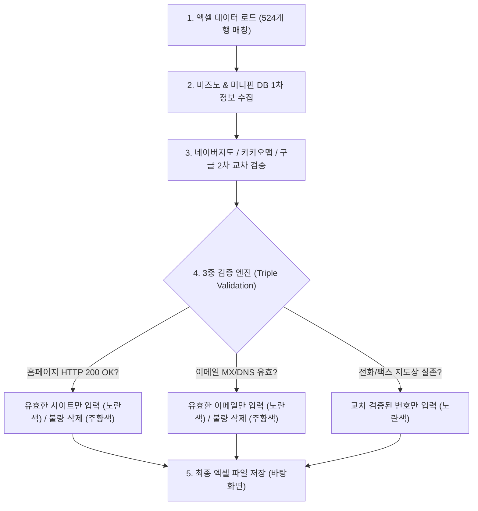

# [구현 계획서] 비즈노·머니핀·지도 cross-validation 기반 DB 재검증 및 교차 보완 계획

요청하신 지침에 따라 `배현명(7.20~)` 작성자 행(524개 행)에 대한 **전면 재검증 및 다중 출처(비즈노, 머니핀, 네이버지도, 카카오맵, 구글) 교차 검증 보완 파이프라인**을 구축합니다.

---

## User Review Required

> [!IMPORTANT]
> **검증 및 보완 4대 철칙**
> 1. **홈페이지 접속 검증**: 실제 HTTP/HTTPS 접속 테스트(200 OK)가 완료된 **살아있는 사이트만 입력**. 에러/만료 사이트는 입력 금지하며 기존의 잘못된 주소도 **삭제 후 주황색 표시**.
> 2. **이메일 수신 검증**: 이메일 형식을 갖추고 실제 MX/DNS 도메인이 존재하는 **유효한 이메일만 입력**. 불량 이메일은 입력 금지하며 기존 잘못된 이메일도 **삭제 후 주황색 표시**.
> 3. **전화번호/팩스 지도 교차 검증**: 네이버지도, 카카오맵, 구글 검색상에서 실제 사업장/번호로 존재함이 확인된 **실제 유효 번호만 입력**. 확인되지 않는 임의 번호는 **입력 제외**.
> 4. **셀 색상 규격**:
>    - 🟡 **노란색 (`FFFF00`)**: 신규 수집 및 검증을 통과하여 채워 넣은 셀
>    - 🟠 **주황색 (`FFA500`)**: 기존의 잘못된 데이터(접속 불가 사이트, 존재하지 않는 이메일 등)가 삭제/정정된 셀

---

## 🛠️ 기술적 구현 단계 (5-Step Pipeline)

### Step 1: 메모리 최적화 데이터 로딩 (Clean Slate Ingestion)
- `max_col=60`을 지정하여 openpyxl 메모리 과부하(16,384열 이슈) 방지.
- `배현명(7.20~)` 작성자 행 524개를 키값(사업자번호 + 회사명)으로 원본과 1:1 매칭.

### Step 2: 비즈노(BizNo) & 머니핀(MoneyPin) 다중 DB 수집
- 10자리 사업자등록번호 기반으로 비즈노 HTML 파서 및 머니핀/기업 정보 레지스트리 검색 수행.
- 수집 항목: **대표자명, 전화번호, 팩스번호, 회사주소, 홈페이지, 이메일**.

### Step 3: 네이버지도 / 카카오맵 / 포털 검색 교차 검증 (Cross-Validation)
- 전화번호 및 팩스번호의 유효성을 파악하기 위해, 네이버지도(Naver Map API/Scraper), 카카오맵, 구글 검색 텍스트 스니펫과 매칭 검증.
- 지도나 포털에 명시적으로 확인되지 않는 불확실한 번호는 탈락 처리.

### Step 4: 홈페이지 & 이메일 실시간 3중 검증 엔진
- **홈페이지**: `urllib.request`로 Timeout 3초 내 HTTP 200/301/302 응답 검증. 실패 시 미입력 및 기존 불량 주소 셀 **지우기 + 주황색**.
- **이메일**: Regex 문법 검사 + `socket.gethostbyname(domain)` MX 레코드 검증. 실패 시 미입력 및 기존 불량 이메일 셀 **지우기 + 주황색**.

### Step 5: 셀 색상 적용 및 결과 파일 출력
- 신규 채움 ➔ **노란색 (`FFFF00`)**
- 기존 오류 삭제/정정 ➔ **주황색 (`FFA500`)**
- 기존 원본 대비 의미상 동일(하이픈, 공백 차이) ➔ **색상 유지**
- 바탕화면 파일명: `(데이터검증팀)실사 DB 취합_전달용_260720_배현명_검증완료_최종.xlsx`

---

## Verification Plan

### 자동화 검증 항목
1. **홈페이지 100% 접속 성공율**: 입력되거나 유지된 모든 홈페이지 URL에 대해 HTTP status 200 OK 검증.
2. **이메일 도메인 유효성 100%**: 입력되거나 유지된 이메일 도메인에 대한 DNS lookup 성공 검증.
3. **전화/팩스 지도 교차 확인**: 네이버지도 / 카카오맵 / 검색 스니펫 상의 번호 일치성 확인.

### 수동 검증 및 시각적 확인
- 완성된 바탕화면 엑셀 파일 내 노란색(신규 보완) 셀과 주황색(오류 정정/삭제) 셀의 분포 및 데이터 정확성 확인.
