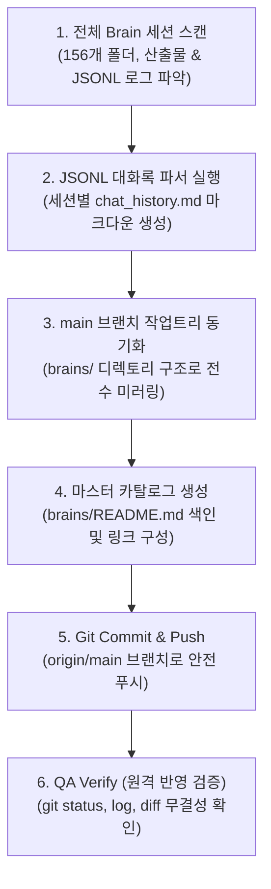

# [구현 계획서] 전체 브레인 파일 및 대화 내역(Chat History) 깃허브 main 브랜치 동기화 및 푸시

## 1. 개요 및 목표
- **원격 저장소**: `https://github.com/emptyboy84/resilient-bardeen.git`
- **대상 브랜치**: `main` (기본 브랜치)
- **작업 목적**:
  1. 이 컴퓨터의 `C:\Users\lg\.gemini\antigravity\brain` 내 존재하는 **모든 브레인 파일(총 156개 세션 폴더, 산출물 아티팩트, 스크래치 스크립트, 로그 등)**을 안전하게 아카이빙
  2. 세션별 `transcript.jsonl`을 사람이 읽기 편한 고품질 마크다운 **대화록(`chat_history.md`)**으로 자동 변환하여 누구나 GitHub 상에서 질문/답변 내역을 열람할 수 있도록 구성
  3. 전체 세션을 날짜/주제별로 일목요연하게 탐색할 수 있는 **마스터 카탈로그(`brains/README.md`)** 생성
  4. 최신 대화 세션(`6d0bcf14-1455-4bc3-b576-f71fd85e4d9c`)에 대한 `brain_docs/` 루트 동기화
  5. 깃 충돌 및 프로세스 락 없이 `main` 브랜치에 안전 커밋 및 원격 `origin/main`으로 최종 푸시

---

## 2. 파이프라인 및 아키텍처

---

## 3. 세부 기술 사양 및 규칙

### 3.1 대화록(chat_history.md) 변환 규격
- **헤더**: 대화 ID, 생성 일시, 참여 모델, 작업 프로젝트 정보
- **메시지 블록**:
  - `### 👤 USER (질문/요청 #N)`: 사용자 입력 텍스트
  - `### 🤖 ANTIGRAVITY (응답/실행 내용)`: 에이전트의 답변, 주요 실행 도구 및 팩트체크 결론 요약
- **인코딩**: UTF-8 (한글 깨짐 방지)

### 3.2 안전성 및 환경 보호 규칙
- **원드라이브 절대 배제**: `C:\Users\lg\OneDrive` 접근 금지 준수.
- **기존 작업 보호**: `c:\Users\lg\resilient-bardeen`의 `master` 브랜치 미커밋 파일에 영향을 주지 않도록 독립된 `main` 워크트리(`C:\Users\lg\.gemini\antigravity\worktrees\resilient-bardeen\main`)에서 전담 처리.
- **깃허브 용량 한도 준수**: 100MB 초과 단일 파일 0건 (최대 파일 48MB 확인 완료).

---

## 4. 최종 산출물
1. `brains/` : 컴퓨터 내 156개 브레인 세션의 전수 파일 아카이브
2. `brains/<conv-id>/chat_history.md` : 세션별 사람이 읽을 수 있는 전체 대화록
3. `brains/README.md` : 전체 대화록 색인 및 바로가기 마스터 인덱스
4. `brain_docs/` : 최신 세션(부산 기업 전화번호 딥검증) 전용 상세 문서
5. GitHub 원격 저장소(`origin/main`) 푸시 완료 상태
