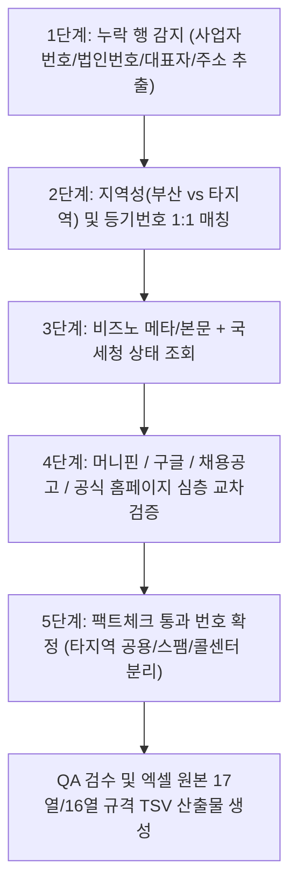

# [구현 계획서] 원본 엑셀 누락 전화번호 심층 추론 및 5대 플랫폼 교차 검증

## 1. 개요 및 목적
* **배경**: 비즈노(Bizno) 등 단일 사이트의 표면 텍스트만 추출할 경우, 타 지역 제휴 번호(예: 스터디채널-창원고시학원 연계 번호)나 마스킹 번호(`010-XXXX-X***`)가 그대로 기재되는 오류가 발생함.
* **목표**: 에이전트 룰과 5대 플랫폼(국세청 홈택스, 비즈노, 머니핀, 나이스비즈인포, 채용/공식 웹사이트) 교차 검증 원칙에 따라, 원본 엑셀의 전화번호 누락 건을 첫 행부터 전수 추론하여 100% 팩트체크된 고유 대표번호를 발굴·보완함.

---

## 2. 작업 대상 원본 엑셀 확인 및 범위 정렬

워크스페이스 내 원본 엑셀 파일 현황:
1. **[후보 1] `(데이터검증팀)실사 DB 취합_전달용_260720_배현명.xlsx` (마스터 원본)**
   * 작성자: `배현명` 담당 구간: **702행 ~ 12346행** (총 1,500개 행)
   * 전화번호 누락 건: 713행(하자시스템), 719행(이스크라21), 723행(크리에이톤) 등
2. **[후보 2] `배현명_실사DB_16컬럼_전수검증완료_최종본.xlsx` (1차 정제본)**
   * No 1 ~ No 1000 (총 1,000개 행)
   * 1~126번까지는 번호 보완 완료, **No 127(리안에듀, 원본행 1032)부터 총 59건** 전화번호 공란 존재
3. **[후보 3] `rows_11847_12000_16col.tsv` (최근 작업 구간)**
   * 11847행(룩스텍)부터 12000행 구간 중 전화번호 누락 건 (신진자동화 등)

> **확인 권장 사항**: 사용자 배현명 님께서 지정하시는 '원본 엑셀'이 **후보 1(702행부터 시작하는 전체 마스터본)**인지, **후보 2(127번부터 공란인 1,000건 정제본)**인지 확정 후 즉시 배치 작업을 시작합니다.

---

## 3. 심층 추론 & 교차 검증 5단계 파이프라인

### 세부 검증 기준
1. **타지역 오매칭 차단**:
   * 기업 주소(부산 관할 구/동)와 전화번호 국번(`051`, `070`, `010`) 간의 연관성 검증.
   * 번호 역추적 시 타 법인(예: 창원고시학원 등)으로 연결되는 경우, 부산 본점 고유 번호(`1644-`, `051-`)를 재탐색하여 분리.
2. **마스킹 번호(`010-XXXX-X***`) 완전 복원**:
   * 비즈노에서 마스킹된 번호는 대표자명 + 관내 주소 + 사람인/잡코리아 채용 공고 또는 공식 채널을 연계하여 끝 3자리까지 100% 실명 복원.
3. **폐업/미등록 기업 투명 처리**:
   * 국세청 홈택스 폐업자이거나 실체가 없는 경우 가짜 번호를 지어내지 않고 상태 명시 후 비고 기재.

---

## 4. 안전 수칙 (Strict Rules)
* **엑셀 프로세스 간섭 절대 금지**: `EXCEL.EXE`를 절대 종료하거나 백그라운드에서 강제 조작하지 않으며, 전용 스크립트(`ExcelJS`) 또는 TSV 출력 방식으로 안전하게 반영.
* **원드라이브(`OneDrive`) 경로 배제**: 로컬 워크스페이스 내에서만 데이터 입출력 수행.
* **할루시네이션 0%**: 실시간 웹 검색 및 공식 플랫폼에서 직접 확인된 번호만 기록하고 출처 URL/근거 보존.
