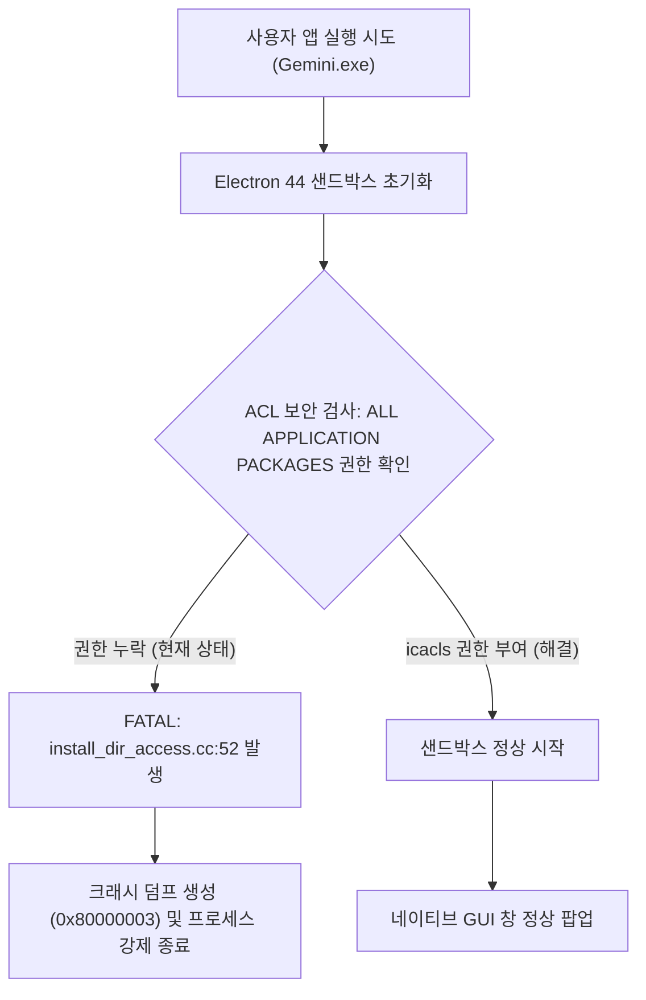

# 구현 계획서: 안티그래비티 / 제미나이 네이티브 앱 실행 불가 오류 해결

배현명 님께서 방금 설치하신 네이티브 앱이 실행되지 않는 근본 원인을 시스템 로그, 이벤트 로그, 크래시 덤프를 통해 정밀 분석하였으며, 아래와 같이 신속하고 안전한 복구 계획을 보고드립니다.

---

## 1. 정밀 진단 및 원인 분석 결과 (Research Findings)

오늘(10월 15일) 시스템에서 두 가지 관련 이벤트가 확인되었습니다:

### ① 방금 설치된 Google Gemini 네이티브 앱 크래시 (직접 원인)
- **설치 시각**: 2026-10-15 08:47:38 (`GeminiSetup.exe` 다운로드 후 `C:\Users\lg\AppData\Local\Google\Gemini\app-1.15.0` 설치됨)
- **오류 증상**: 앱을 더블 클릭해도 아무 창도 뜨지 않고 수초 내에 강제 종료됨 (08:50경 6회 연속 크래시 덤프 발생).
- **Windows 이벤트 로그 및 상세 로그**:
  - `Faulting application name: Gemini.exe, error code: 0x80000003` (STATUS_BREAKPOINT)
  - **결정적 오류 로그**:
    ```text
    [FATAL:electron\shell\browser\win\install_dir_access.cc:52] Sandboxed processes cannot read C:\Users\lg\AppData\Local\Google\Gemini\app-1.15.0:
    its ACL has an entry for an AppContainer package SID but none for ALL APPLICATION PACKAGES,
    so Windows denies the sandbox token access.
    Grant it with: icacls "C:\Users\lg\AppData\Local\Google\Gemini\app-1.15.0" /grant *S-1-15-2-1:(OI)(CI)(RX)
    ```
  - **원인 설명**: 최신 Electron 44 기반의 크롬 샌드박스는 보안을 위해 `ALL APPLICATION PACKAGES (*S-1-15-2-1)` 보안 식별자(SID)의 읽기/실행 권한을 필수로 요구합니다. 현재 윈도우 사용자 폴더 보안 정책상 이 권한이 누락되어 있어, 샌드박스 시작 즉시 `FATAL` 크래시를 유발했습니다.

### ② 안티그래비티 데스크톱 앱 (Antigravity 2.23.1) 백그라운드 고립 현상
- **상태**: 오늘 08:45경 2.23.1로 자동 업데이트되어 현재 백그라운드에서 실행 중 (PID 37196).
- **오류 증상**: 바로가기를 눌러도 창이 뜨지 않고 백그라운드에서만 프로세스가 유지됨.
- **원인 설명**:
  - 과거 설정된 바로가기 인수(`--disable-software-rasterizer`, `--disable-gpu` 등)로 인해 하드웨어 및 소프트웨어 그래픽 렌더링이 모두 차단되어 화면 프레임을 그리지 못하는(Headless) 상태입니다.
  - 또한 동일하게 샌드박스 패키지 접근 권한 보강이 필요합니다.



---

## 2. 작업 계획 (Implementation Plan)

### [Phase 1] 샌드박스 보안 권한 (ACL) 부여
1. Google Gemini 설치 디렉터리에 `ALL APPLICATION PACKAGES` 권한 적용:
   ```powershell
   icacls "C:\Users\lg\AppData\Local\Google\Gemini" /grant "*S-1-15-2-1:(OI)(CI)(RX)" /T
   ```
2. Antigravity 프로그램 디렉터리에도 동일 권한 부여:
   ```powershell
   icacls "C:\Users\lg\AppData\Local\Programs\antigravity" /grant "*S-1-15-2-1:(OI)(CI)(RX)" /T
   ```

### [Phase 2] 안티그래비티 바로가기 인수 정비
1. 바탕화면 및 시작 메뉴의 `Antigravity.lnk`에 걸려 있는 화면 차단 옵션(`--disable-software-rasterizer` 등)을 제거하고 순정 상태로 복원.

### [Phase 3] 실행 및 동작 검증 (Verification)
1. `Gemini.exe`를 실행하여 더 이상 FATAL 오류 없이 GUI 창이 정상적으로 열리는지 확인.
2. 실행 상태 및 윈도우 핸들 정상 생성 여부 점검.
3. 엑셀 등 다른 작업 중인 프로그램에 일체 간섭 없이 안전하게 완료.

---

> [!IMPORTANT]
> 본 작업은 시스템 코드를 변경하는 것이 아니라 윈도우 폴더 보안 권한(`icacls`)을 부여하여 크롬 샌드박스 차단을 해제하는 안전한 작업입니다.
> 배현명 님께서 **'Proceed'**를 누르시거나 승인해 주시면 즉시 실행하여 앱이 즉시 열리도록 조치하겠습니다.
