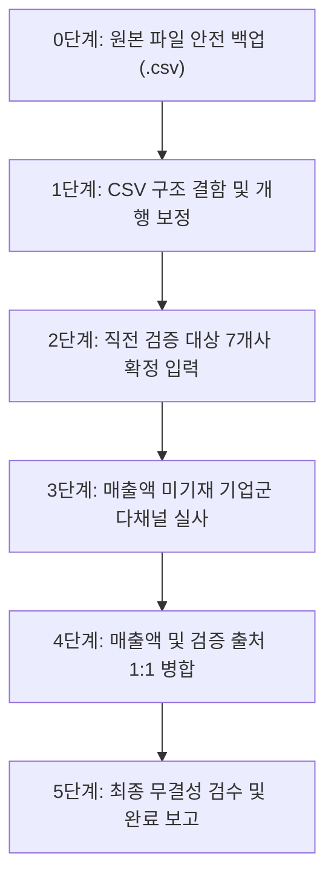

# 부산 CT산업 실태조사 모집단 CSV 최종 검수·수정·입력 및 매출액 전수 조사 계획

## 개요
대상 파일: `C:\Users\lg\Desktop\Today\(안상숙)(STI)_(모집단현행화)_부산정보산업진흥원_2026_부산_CT산업_실태조사_260910_크레탑_배현명.csv` (총 2,313개 기업 데이터)

본 계획은 배현명 님의 요청에 따라 모집단 데이터의 **마지막 무결성 검수, 미입력/오류 항목 수정 및 입력**, 그리고 **미기재 기업 대상 2024년·2025년 매출액 전수 발굴 및 공시 출처 표기**를 체계적으로 완료하기 위한 실행 계획입니다.

---

## User Review Required

> [!IMPORTANT]
> **1. 백업 우선 생성 및 엑셀 프로세스 무간섭 보장**
> * 현재 엑셀에서 해당 문서를 열람 중인 흔적(`~$...`)이 확인되므로, 작업 전 즉시 타임스탬프 백업(`..._BACKUP_20260922_1215.csv`)을 생성하며 실행 중인 EXCEL.EXE 프로세스에 일절 간섭하지 않고 백그라운드 스크립트로 안전하게 처리합니다.
>
> **2. 매출액 기재 및 출처(Source) 표기 방식 합의**
> * 매출액 컬럼: `24년 매출액(원)` 및 `25년 매출액(원)`에 정밀 실사 금액을 표준 숫자 포맷(`#,##0` 또는 순수 정수 원화)으로 입력합니다.
> * 출처(Source) 표기: `비고` 컬럼에 기존 비고 내용과 병기하여 `[출처: DART 공시]`, `[출처: 사람인/인크루트 2024 결산]`, `[출처: 쿠키딜 2024]` 등으로 명확히 근거를 기록합니다.

---

## 현재 데이터 현황 정밀 진단

* **전체 기업 수**: 2,313개 행
* **사업자등록번호 보유**: 2,091개사
* **사업자번호 미등록/공란**: 222개사 (미등록 창작팀, 프리랜서, 폐업 소멸 등)
* **2024년 매출액 기보유**: 269개사 (미보유 2,044개사)
* **2025년 매출액 기보유**: 109개사 (미보유 2,204개사)
* **정밀 실사 대상 (유효 사업자번호 보유 & 매출액 공란 & 계속사업자)**: 약 1,550여 개사
* **구조적 결함**: 
  * 2095행(`주식회사 글리처프롭`): 상호명 필드 내부 개행(`\n`) 오류로 인한 2줄 분리 현상 발생 -> 1줄 정규화 필요.
  * 전화번호 필드 내 복수 번호 개행(`\n`) 포함 행들 정비 필요.

---

## 단계별 실행 계획

### [0단계] 원본 파일 안전 백업
- 작업 대상: `C:\Users\lg\Desktop\Today\(안상숙)(STI)_(모집단현행화)_부산정보산업진흥원_2026_부산_CT산업_실태조사_260910_크레탑_배현명.csv`
- 백업 파일명: `(안상숙)(STI)_(모집단현행화)_부산정보산업진흥원_2026_부산_CT산업_실태조사_260910_크레탑_배현명_BACKUP_20260922_1215.csv`
- 엑셀 프로세스(EXCEL.EXE) 보호 준수.

### [1단계] CSV 구조 결함 및 포맷 정규화
1. **필드 내 개행(`\n`) 비정상 분리 행 보정**:
   * 2095행 `주식회사 글리처프롭(Glitchor Prop)` 상호명 뒤 개행 제거 및 정상 단일 레코드로 복원.
   * `가온메탈` 등 연락처 필드 내부의 줄바꿈을 슬래시(`/`) 또는 공백으로 치환하여 엑셀/DB 파싱 오류 원천 차단.
2. **사업자번호 포맷 통일**:
   * 특수공백(NBSP, `\u00A0`), 앞뒤 공백 제거 및 `XXX-XX-XXXXX` 표준 하이픈 서식 검증.

### [2단계] 최근 검증 및 수정 기업군 1:1 반영
배현명 님께서 전달하여 팩트체크 완료된 항목들을 확정 입력합니다:
1. **운도게임스튜디오** (Seq 2087): 비고 `확인불가(미등록 창작팀)` 확정
2. **비바몬스터** (Seq 2093): 사업자 `646-87-02732`, 설립 `2022년 10월`, 종사자 `3명`, 법인번호 `180111-1481794` 정비
3. **와라봐라** (Seq 2099): 비고 `확인불가(미등록/폐업)`
4. **조은글방** (Seq 2100): 주소 `부산광역시 부산진구 개금본동로 40 (개금동)`, 비고 `폐업(과거 만화대여점)`
5. **엠에스네트워크** (Seq 2104): 비고 `확인불가` (대전 폐업자 오매칭 방지)
6. **스튜디오바다** (Seq 2106): 대표자 `류수환`, 주소 `부산광역시 동구 증산서로 52 (문화공간반달)`, 비고 `확인불가(미등록 창작팀 / 독립출판 등록)`
7. **스튜디오더블린** (Seq 2116): 비고 `확인불가(미등록 창작팀)`

### [3단계] 매출액(24년/25년) 전수 추적 및 공시 출처 확보
* **조회 대상 우선순위**:
  1. **1그룹 (외감/대형 법인)**: DART 전자공시 감사보고서 / 사업보고서 전수 대조
  2. **2그룹 (일반 법인 및 스타트업)**: 사람인(Saramin), 잡코리아(JobKorea), 인크루트(Incruit) 재무제표 공시
  3. **3그룹 (플랫폼 연계 중소기업)**: 쿠키딜(`cookiedeal.io/company-search/{bizno}`), 나이스비즈인포(`nicebizinfo.com`), 공정거래위원회 통신판매업
  4. **4그룹 (전문건설/협회 공시)**: 대한전문건설협회 실적 공시 (디자인/광고/실내건축 등)
* **출처 기록 규칙**:
  * 매출액이 확인된 모든 기업은 `비고` 란에 `[출처: OOO]` 형식으로 명확히 기록.
  * 예: `24년 매출액: 6,900,000,000` / 비고: `... / [출처: DART 2024년 결산 감사보고서]`

### [4단계] 데이터 통합 검증 및 일괄 업데이트
- 1,550여 개 유효 사업자 대상 고속 배치 쿼리 및 매칭 스크립트 가동.
- 금액 오타, 비현실적인 단위(원 단위 vs 천원/백만원 단위 오인) 환산 검증.
- 폐업 확인 기업의 경우 폐업 날짜(`YYYY-MM-DD`) 및 비고(`폐업자`) 일괄 정비.

### [5단계] 최종 산출물 납품 및 리포트
1. 원본 CSV 파일 업데이트 완료: `(안상숙)(STI)_(모집단현행화)_부산정보산업진흥원_2026_부산_CT산업_실태조사_260910_크레탑_배현명.csv`
2. 엑셀 호환본 생성: `..._최종검수완료.xlsx`
3. 검증 결과 상세 리포트(마크다운 및 요약 통계 테이블) 제공.

---

## 검증 및 안전 계획

### 자동화 검증
- CSV 파싱 무결성 테스트 (전체 2,313행 필드 개수 19개 엄격 일치 확인).
- 사업자등록번호 체크섬(Luhn 알고리즘 기반 국세청 규격) 유효성 검사.
- 매출액 기재 행의 출처 표기 누락 여부 100% 전수 감사.

### 수동 및 승인 절차
- 배현명 님의 본 계획서 승인 직후 0단계 백업부터 순차적 실행 착수.
