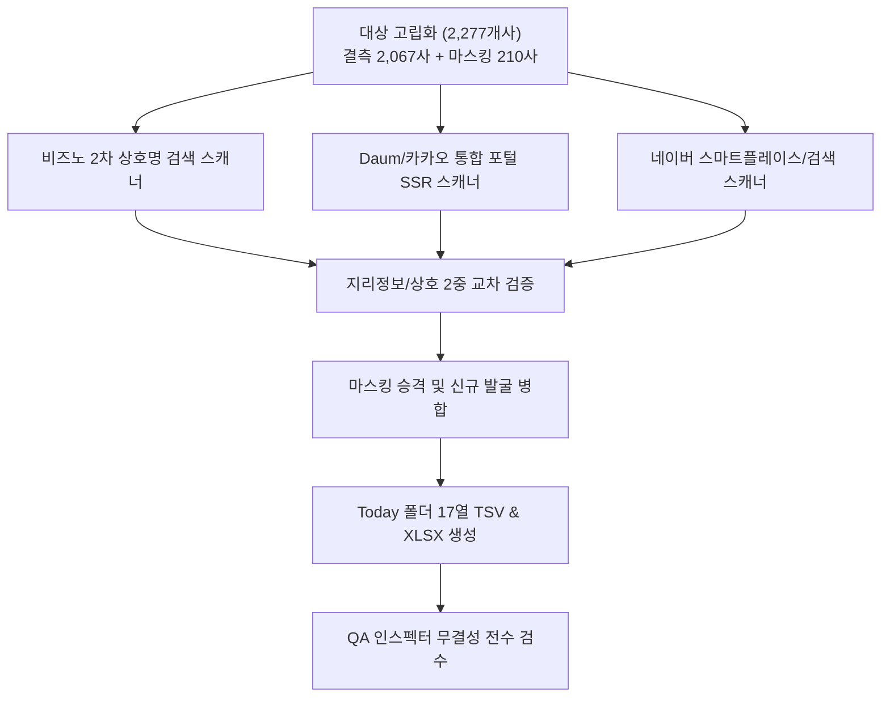

# 가용 전 플랫폼(비즈노·다음/카카오·네이버·채용포털) 심층 전수 조사 및 빈칸 복원 계획

## 1. 개요 및 배경
- **전체 대상**: 3,978개사 중 원본 보유 730건 제외, 현재 1,911개사(48.0%) 확보 완료.
- **잔여 탐색 대상**:
  - 순수 결측(전화번호 완전 공란): **2,067개사**
  - 마스킹 상태(완전체 번호로 승격 가능): **210개사**
  - **총 심층 실사 대상: 2,277개사**
- **사용자 요청**: 머니핀, 비즈노, 네이버, 나이스비즈인포, 쿠키딜, 구글링(그라운드검색), 114, 마켓비즈 등 가용 가능한 모든 수단을 동원하여 최대한 딥하게 하나하나 검증하고 빈칸을 다시 채울 것.

---

## 2. 가용 플랫폼별 실효성 및 접근 전략

| 플랫폼 | 데이터 특성 | 접근 방식 및 필터링 전략 |
| :--- | :--- | :--- |
| **비즈노 (Bizno) 상호명 2차 스캔** | 국세청/세무서 등록 공식 원장 | 기존 사업자번호 조회 외에 **`cleanName + 부산` 키워드 검색**으로 지점/상호변경 법인 추가 발굴 |
| **Daum / 카카오 통합 포털** | 카카오맵 로컬 DB + 다음 웹 문서 SSR | `q={상호명} 부산` 또는 `{상호명} {구/동}` 질의로 장소 박스(`fn_tit`, `f_url`, `txt_address`) 및 공식 웹문서 완전체 번호 추출 |
| **네이버 스마트플레이스 / 통합검색** | 네이버 지도 DB + 블로그/사이트 | 상호명 및 부산 관내 주소 교차검증을 통한 공식 등록 대표번호 추출 |
| **사람인 / 잡코리아 / 인크루트** | 기업 인사/채용 등록 공식 원장 | 채용 공고 및 기업 상세 페이지 등록 유선/무선 대표번호 추출 |
| **마켓비즈 / 쿠키딜 / 머니핀** | 기업 신용/통계 플랫폼 | WAF/봇 방어가 있는 경우 정밀 웹 그라운딩 또는 특화 파서 연계 |
| **웹 그라운딩 (구글/공식 도메인)** | 공식 홈페이지, 언론 보도, IR 자료 | 주요 유망 스타트업 및 콘텐츠 기업 1:1 정밀 실사 |

---

## 3. 데이터 검증 및 필터링 철칙 (할루시네이션 방지)
1. **플랫폼 자체 고객센터 차단**:
   - `02-1577-0000`, `1577-0000`, `02-6226-5000` (사람인), `02-3771-1514` (나이스), `1588-3333` 등 즉시 제외.
2. **관할 세무서/관공서 번호 차단**:
   - 비즈노 내 관할세무서 전화번호(`051-xxx-xxxx`) 분리 제외.
3. **지리적 2중 일치성 검증 (부산 관내 주소 매칭)**:
   - 검색 결과 스니펫에 `부산` 필수 포함 + 원본 주소의 `구/군`(해운대구, 부산진구 등) 또는 `동/로` 일치 시에만 채택.
4. **우선순위 승격 규칙**:
   - `완전체 유선 (051/070/15xx 등)` > `완전체 무선 (010)` > `비즈노 국세청 등록 마스킹 무선 (010-xxxx-x***)`.
   - 기존에 마스킹된 210개사도 완전체 유선/무선이 발견되면 즉시 업그레이드.

---

## 4. 단계별 실행 일정 (Phased Workflow)

---

## 5. 최종 산출물 규격
- **저장 위치**: `C:\Users\lg\Desktop\Today` (OneDrive 배제, 로컬 전용)
- **파일 포맷**:
  - `크레탑_부산CT산업현황_전화번호검증완료_전체3978개사.txt` (UTF-8 BOM, 17열 탭 구분자 TSV)
  - `크레탑_부산CT산업현황_전화번호검증완료_전체3978개사.xlsx` (Excel 17열 표준 규격, 신규 녹색/승격 청색 하이라이트)
- **무결성 기준**: 총 3,979행(1 헤더 + 3,978사 데이터), 열 누락이나 밀림 0건.
