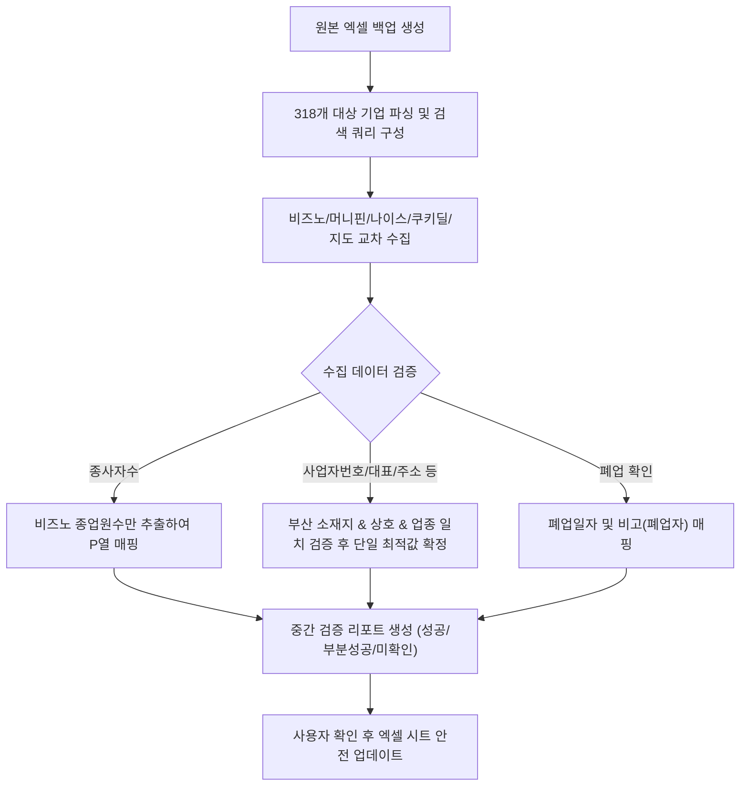

# [부산 CT산업 실태조사 모집단 현행화] 사업자번호 누락 업체 데이터 검증 및 입력 계획

본 계획서는 `(안상숙)(STI)_(모집단현행화)_부산정보산업진흥원_2026_부산_CT산업_실태조사_260910_크레탑_배현명_.xlsx` 파일의 전체 패턴을 분석하고, **사업자번호가 누락된 업체(318개사)**를 대상으로 신뢰도 높은 단일 데이터를 구축·검증하기 위한 절차입니다.

---

## 1. 엑셀 데이터 분석 및 패턴 현황

### (1) 시트 구성 및 상태
- **기업체 리스트**: 전체 2,469행 (헤더 1행 + 데이터 2,313행 + 말미 공백 155행)
  - `25년 모집단`: 2,269개 업체
  - `게임사업단 리스트`: 42개 업체
  - 기타/분류: 2건
- **개인 리스트**: 1,022행 (사업자번호 컬럼 없음, 1인 미디어/개인 프리랜서 리스트 -> 작업 대상 제외)

### (2) 현행화 타깃: '사업자번호 누락' 318건 분류
사업자번호가 이미 존재하는 1,995개사는 보존하며, **사업자번호가 비어있는 318개사**만을 대상으로 조사를 진행합니다.

| 보유 단서 유형 | 대상 수 | 특징 및 탐색 전략 |
| :--- | :---: | :--- |
| **유형 A (상호 + 전화번호 + 주소)** | **160건** | 주소 및 유선/휴대전화가 모두 있어 매칭 정확도가 가장 높음 |
| **유형 B (상호 + 주소)** | **81건** | 센텀스카이비즈, 큐비이센텀, 부산문화콘텐츠콤플렉스 등 지식산업센터/빌딩 호수 기반 정밀 탐색 |
| **유형 C (상호 + 전화번호)** | **66건** | 전화번호(지역번호 051 또는 대표자 휴대전화)와 상호 조합으로 부산 소재 기업 역추적 |
| **유형 D (상호 단독 또는 대표자만 존재)** | **11건** | 동음이의어 위험이 크므로 업종분류(공연, 출판, 방송, 캐릭터 등)와 교차 필터링 |

---

## 2. 현행화 및 데이터 입력 원칙

### [규칙 1] 종사자수 입력 규칙: '비즈노(Bizno) 전용 고정'
- **종사자수(명) 25년 기준 (P열)**:
  - 오직 **비즈노(bizno.net)**의 `종업원수` 필드 값만 추출하여 입력.
  - 비즈노에 종업원수 데이터가 없거나 미제공 상태인 경우, 임의 추정하거나 타 사이트 수치를 넣지 않고 **공란 유지**.

### [규칙 2] 기타 정보 입력 규칙: '다채널 교차 검증 후 최적 1건 선정'
- **대상 필드**: 사업자번호(D열), 설립연도(E열)/월(F열), 대표자 성함(G열), 연락처(H열), 주소(K열), 시군구(J열), 폐업정보(N, O열)
- **탐색 소스**:
  1. **기업정보 포털**: 비즈노(bizno.net), 머니핀(moneypin.biz), 나이스비즈인포(nicebizinfo.com), 쿠키딜(kookiedil.com)
  2. **지도/공간 포털**: 네이버 지도, 카카오맵 (최신 이전 주소, 실제 영업 여부, 전화번호 교차 확인)
- **선정 원칙**:
  - 데이터 간 불일치가 발생할 경우: **국세청 홈택스 실시간 연동 정보 > 공공데이터/지자체 등록부 > 지도 최신 등록 정보** 순으로 신뢰도를 평가하여 **가장 신뢰할 수 있는 단 하나의 값만 입력**.
  - 폐업 확인 시: `폐업 날짜` 및 비고(`폐업자`) 표기 패턴을 기존 시트 포맷(`MM-DD-YY` 또는 `YYYY-MM-DD`)에 일치시킴.

### [규칙 3] 시스템 및 프로세스 안전성 준수
- **현재 실행 중인 Excel 프로세스(EXCEL.EXE) 보호**: 프로세스를 강제 종료(kill)하지 않고 백그라운드 파이썬 스크립트로 안전하게 처리.
- **작업 전 원본 자동 백업**: 수정 전 원본 파일을 타임스탬프 백업본으로 복제 생성 후 작업.

---

## 3. 세부 단계별 실행 및 검증 계획 (Verification & Execution Workflow)

### 1단계: 안전 백업 및 타깃 데이터 추출
- 대상 파일 복제 백업 (`..._배현명_BACKUP_YYYYMMDD_HHMMSS.xlsx`).
- 318개 행의 상호명, 주소, 전화번호, 대표자명, 업종을 구조화된 작업 큐(JSON)로 저장.

### 2단계: 다채널 자동/정밀 수집 스크립트 가동
- 검색 우선순위 적용:
  - 1순위: 상호명 + 부산 + (주소 내 동/구 또는 지식산업센터명)
  - 2순위: 등록 전화번호 일치 조회
  - 3순위: 대표자명 + 상호명 결합 조회
- 사이트별 수집:
  - **비즈노**: 사업자번호, 대표자, 설립일(연/월), 종업원수(종사자수), 사업상태(계속/폐업/폐업일)
  - **머니핀 / 나이스비즈인포 / 쿠키딜**: 비즈노 누락 항목 상호 보완 및 사업자번호 일치 검증
  - **네이버지도 / 카카오맵**: 상호 변경, 최신 도로명 주소 정밀화, 최신 연락처 확보

### 3단계: 정밀 필터링 및 할루시네이션 차단 검증 (QA Verification)
- **지역 유효성 검사**: 서울, 경기 등 부산 외 타지역 동명 기업 매칭건 자동 배제.
- **사업자번호 형식 검사**: `10자리(XXX-XX-XXXXX)` 유효성 체크 및 중복 여부 확인.
- **종사자수 무결성 검사**: 비즈노 외 타 출처 수치 유입 원천 차단 (비즈노 출처만 허용).
- **결과 분류**:
  - `확정(High)`: 사업자번호 및 종사자/주소 매칭 100% 완료
  - `단일출처 매칭(Medium)`: 지도 또는 단일 포털에서만 확인된 경우
  - `미확인(Low)`: 폐업 추정 또는 검색 불가 (사용자 별도 승인 리스트로 분리)

### 4단계: 사용자 리뷰용 사전 보고서(Audit Report) 생성
- 엑셀에 바로 덮어쓰지 않고, **318개 업체의 매칭 결과 요약표(HTML/CSV/Markdown)**를 먼저 생성하여 배현명 님께 제출.
- 확인 후 승인된 데이터를 바탕으로 원본 엑셀 파일에 안전하게 반영.

---

## 4. 확인 및 선택 사항 (User Review Required)

> [!IMPORTANT]
> **검증 및 진행 전 확인 사항**
> 1. **검색 실패/완전 미확인 업체 처리**: 1인 기업이나 영세업체 중 온라인 기업정보에 전혀 등록되지 않은 소수 업체의 경우, 주소지/지도 기준으로 최신 상태만 남겨두고 사업자번호를 공란 유지하는 것이 맞는지 확인 부탁드립니다.
> 2. **폐업 업체 표기 포맷**: 폐업 확인 업체의 경우, 기존 시트처럼 `폐업 날짜`에 일자 기재 후 `비고`에 `폐업자`로 표기하면 되는지 확인 부탁드립니다.

위 검증 계획을 확인하시고 피드백을 주시면, 즉시 1차 백업 및 318개사 정밀 조사를 진행하겠습니다.
